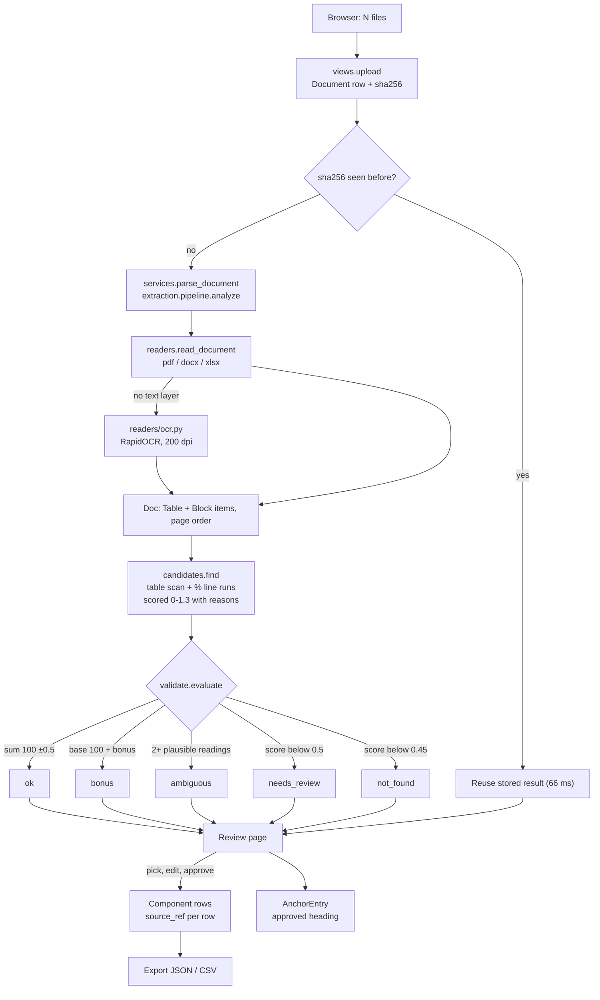

# BRP Assessment Parser

Bulk-parse UI BRP / silabus documents (PDF, DOCX, XLSX) into assessment components
and weights, review them in the browser, then export JSON or CSV.

No LLM: detection is structural (numeric weight columns and percentage line runs),
so results are reproducible and auditable. Every component keeps its `source_ref`.

- Upload many files at once (≤ 20 MB each), parse inline.
- Nothing is trusted automatically: the parser offers candidates, a human picks.
- Same file uploaded twice costs nothing (SHA-256 dedupe).
- Scanned PDFs are OCR'd (RapidOCR, bundled ONNX models) instead of skipped.

## Architecture



The gate, in one line: a candidate must score at least 0.5 to be offered, at
least 0.45 for the document to count as having an assessment section at all,
and two independent plausible readings always become `ambiguous` instead of a
silent winner.

### Modules

| Path | Job |
| --- | --- |
| `assessments/views.py` | upload, batch list, review, reparse, export, coverage |
| `assessments/services.py` | hashing, dedupe, materialising components, calling the pipeline |
| `extraction/pipeline.py` | one entry point: path → status, candidates, reasons, blocks |
| `extraction/readers/` | per-format readers + OCR fallback; no parsing logic |
| `extraction/components.py` | table rows and text lines → component rows, weight/name column choice |
| `extraction/weights.py` | `25%`, `0,25`, `2 x 7.5`, ranges, bonus detection |
| `extraction/candidates.py` | candidate discovery, scoring, dedupe by weight signature |
| `extraction/validate.py` | tiers, confidence gate, status decision |
| `extraction/ranker.py` | optional logistic regression trained on human approvals |
| `extraction/index.py` | anchors from approved headings (helps similar layouts) |

The extractor is deliberately thin: readers only produce tables and lines with
page provenance, and the only judgement is "does this look like a weighted list
of assessments". No course names, no regex chain per faculty, no hidden model.

### Data model

`Batch` → `Document` (one row per file: status, result JSON, blocks, sha256,
fingerprint, selected candidate) → `Component` (name, weight, raw weight,
formula, source_ref, bonus flag, confidence). `AnchorEntry` stores approved
section headings so a recurring layout ranks higher next time.

`Document.result` keeps **all** candidates and the reasons for the chosen one,
so a review decision can always be traced back to what the parser saw.

### Status meanings

| Status | Meaning |
| --- | --- |
| `ok` | weights sum to 100% |
| `bonus` | base sums to 100%, extra component marked bonus |
| `ambiguous` | two plausible representations (e.g. detail table vs summary list) |
| `needs_review` | candidates exist but fall below the confidence gate |
| `not_found` | no assessment section detected |
| `approved` | a human picked/edited the components |

## Run locally

```sh
uv sync
uv run python manage.py migrate
uv run python manage.py createsuperuser   # optional, for /admin/
uv run python manage.py runserver
```

Open http://127.0.0.1:8000/ and upload one or more files (≤ 20 MB each).
Pages: upload → batch → review → approve. `/coverage/` shows status counts,
structural families of documents, and whether the ranker is trained.

## Run with Docker

```sh
docker build -t brp-parser .
mkdir -p var/media && touch var/db.sqlite3
docker run -d --name brp-run -p 8000:8000 \
  -e DJANGO_SECRET_KEY=change-me \
  -e DJANGO_ALLOWED_HOSTS=localhost,127.0.0.1 \
  -e OCR_THREADS=4 \
  -v "$PWD/var/db.sqlite3:/app/db.sqlite3" \
  -v "$PWD/var/media:/app/media" \
  brp-parser
```

The image is built multi-stage, runs `migrate` then gunicorn with a 300 s
timeout, and serves static files through WhiteNoise, so `/admin/` is styled
without a separate web server. SQLite and uploads survive a container
replacement only if you mount them, as above.

Watch a running container:

```sh
scripts/monitor.sh brp-run 5 var/monitor/stats.log   # append one line per 5 s
tail -f var/monitor/stats.log
docker stats brp-run
```

## Corpus triage without the database

```sh
uv run python manage.py parse_doc docs-example --verbose
```

Prints status, fingerprint, item count and weight sum per file. The same
pipeline runs on upload; identical files are deduplicated by SHA-256.

### Results on `docs-example/`

| Document | Status | Items | Sum | First reason |
| --- | --- | --- | --- | --- |
| BRP Anum 2026/2027 | `ok` | 4 | 100% | weight header `Bobot` |
| BRP MPPI 2026 Ganjil | `ok` | 7 | 100% | OCR used on 2 pages |
| Silabus POK 2025 Ganjil | `bonus` | 6 | 105% | 6 consecutive percentage lines |
| Silabus Jarkom 2026/2027 | `ambiguous` | 7 | 100% | table 15/95% vs lines 7/100% |
| DAA Weekly Plan (xlsx) | `not_found` | 0 | — | no assessment section |
| Silabus Kalkulus 2 | `ambiguous` | 8 | 100% | table 8/100% vs lines 5/105% |
| BRP PBP 2025/2026 | `needs_review` | 3 | 3% | picked a 1-point rubric column |
| BRP 2024/2025 Genap | `ambiguous` | 8 | 100% | two tables, 8/100% vs 7/98% |

Two of these eight are parsed perfectly with no review needed, one is a correct
base-plus-bonus split, three are genuinely two different readings of the same
document (the reviewer picks), and two are wrong but **flagged** — the gate never
returned a bad 100% as `ok`. That is the intended trade: silence is the only
failure mode we refuse.

## Benchmarks

Measured on a 16-core Linux host, Docker container limited to the default
15.47 GiB, `docker stats` sampled every 1–5 s. CPU is relative to one core, so
`800%` means eight cores busy.

### Parse cost

| Workload | Wall time | Peak CPU | Peak RSS |
| --- | --- | --- | --- |
| Idle container | — | 0.02% | 77 MiB (19 pids) |
| `parse_doc` over 5 example files | 17.8 s | ~7 cores (2m03s CPU) | — |
| 6 files uploaded via HTTP (incl. 33-page PDF + 2-page scan) | 35.4 s | 1448% (~14.5 cores) | 492 MiB |
| 2-page scanned PDF, OCR default threads | 9.5 s | 1500% | 438 MiB |
| 2-page scanned PDF, `OCR_THREADS=4`, 240 dpi | 10.7 s | 685% | 341 MiB |
| Re-upload of an identical file (dedupe) | 66 ms | ~0% | flat |
| Review page render | 9–25 ms | ~0% | — |
| CSV export of a batch | 10 ms | ~0% | — |

### Hour-long background sample

100 samples, every 5 s, while the app was used interactively (uploads of
5–8 documents, including 6 OCR'd pages):

```text
avg CPU 6.0%   peak 593%      avg RSS 195 MiB   peak 330 MiB   max 59 pids
```

Idle is flat at ~0.01% / ~79 MiB; memory only climbs when a parse runs. RSS
after a heavy parse settles around 300 MiB rather than returning to 77 MiB —
that is the ONNX arena, not a leak, but it means a long-lived container holds
capacity it is not using.

### Reading the numbers

- **OCR dominates.** Digital PDFs and DOCX are milliseconds of CPU; a scanned
  page costs ~5 s at 4 threads. Default-on multi-threading let a single upload
  eat ~15 cores, so OCR is now capped by `OCR_THREADS` (default 4). The cost of
  the cap measured ~1 s on a 2-page scan for 4× lower peak CPU.
- **The image pays for it.** ~938 MB: ONNX runtime, OpenCV, and the bundled
  detection/recognition models (~16 MB of model weights). Dropping
  `rapidocr-onnxruntime` shrinks the image substantially and turns scans back
  into `needs_review`.
- **One worker serialises uploads.** Gunicorn runs a single sync worker, so a
  40-page scan (OCR cap) holds the queue for minutes. This is the first thing
  to change at real batch sizes: move parsing to a worker and keep the request
  a job submission.
- **Dedupe is the cheapest win.** Reparse and re-upload are O(hash), not
  O(pages), because the result JSON is reused.

## Scanned PDFs

Pages with less than ~40 characters of text are rendered at 200 dpi and OCR'd
with RapidOCR (ONNX, models bundled — no system tesseract). Recognised lines are
fed through the same detectors, plus a rough column grid so a scanned table is
still a table. OCR is capped at 40 pages per file and the reason list says so;
a scanned file is never silently skipped. OCR-derived tables are only accepted
when a weight header is visible, which keeps lecture schedules from being read
as weight columns. To turn OCR off, remove `rapidocr-onnxruntime` — the reader
falls back to `needs_review: no text layer`.

## Learned ranker (optional)

Structural rules decide everything by default. Once documents are approved,
`assessments/extraction/ranker.py` can learn **which candidate the reviewer
picked** from 11 structural signals and use that as a tie-breaker inside the
same validation tier (it can never promote something the rules reject).

```sh
uv run python manage.py train_ranker
```

It refuses to train below 20 candidate rows / 5 approvals, so nothing overfits a
handful of files. The model is plain JSON at `ranker.json` (override with
`settings.RANKER_PATH`), no dependency beyond the standard library. `/coverage/`
shows whether a model is active and on how many labels. The ranker reorders
candidates; it does not extract anything.

## Known limits

- Weights are only found when they are numeric and near the component name.
  Prose rubrics ("mahasiswa mampu…") are not assessment components and are
  ignored by design.
- Wrong-but-confident columns happen: week numbers `9…16` in a schedule sum to
  100 by coincidence, and a 1-point rubric column can be read as weights. Both
  are caught by the gate (`ambiguous` / `needs_review`) and surfaced with a
  reason, never auto-approved.
- No `.doc` or `.pptx` support; convert them first.
- Extraction runs inline on upload (`shortcut: fine for ~20 files per batch,
  move to a queue beyond that`).
- Rubric tables (criteria × levels) are not extracted yet — components and
  weights only.

## Tests

```sh
uv run python manage.py test assessments
```

Covers the golden corpus acceptance table, upload → review → approve → export,
OCR of an image-only PDF, and the ranker's training guard.
